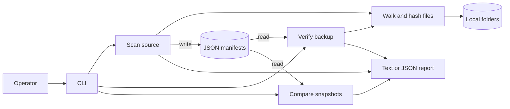

# High-level design

Local Backup Verifier 0.1.0 answers whether a local backup contains every expected regular file with the same bytes. It needs an Ubuntu environment with Python 3.10 or later and ordinary filesystem access. The CLI uses the Python standard library at runtime.

## Workflows

| Command | Operator input | Result |
| --- | --- | --- |
| `scan` | A known-good folder, an output file, and optional selection rules | A portable, versioned SHA-256 manifest and a scan report |
| `verify` | A backup folder and a trusted manifest | A read-only inventory compared with the manifest and a report of matching, missing, changed, extra, and unreadable paths |
| `diff` | An earlier and a later manifest | A report of added, removed, modified, and unchanged paths, alongside both snapshots' scan scope |

Each command runs in one process. `scan` and `verify` share the filesystem walker and SHA-256 implementation. `verify` reconciles the backup inventory with the selected manifest. `diff` works entirely from the recorded entries and can run with both source folders offline. Reports are written to stdout, with diagnostics for failed invocations on stderr.

## Data and trust boundary

- The selected reference manifest supplies the expected hashes. It needs independent protection or authentication if someone could modify it.
- Relative paths and case-sensitive comparison keep the reference usable when a folder moves. `verify` reapplies the reference filters to the new root.
- The inventory covers regular-file paths and contents. Empty directories, permissions, timestamps, ownership, and link targets are outside the manifest's scope. Symbolic links are recorded as skipped.
- Files are hashed with bounded buffers, and the walker surfaces read errors and detectable changes. The walk observes individual files over time. An atomic point-in-time view requires a filesystem snapshot or a quiescent folder.
- A partially readable source can produce a diagnostic manifest. A partial reference, a backup inspection failure, or a discrepancy prevents a successful verification result.

## Configuration and credentials

Folders, manifest paths, filters, and output format are supplied at runtime through the [CLI arguments](cli-and-data-contracts.md). The CLI uses local OS permissions and needs no service account, login, environment file, or API key. CI uses GitHub-provided read access for checkout and disables credential persistence.

Examples use synthetic paths or placeholders such as `<source-dir>` and `<manifest-file>`. Supply repository-specific account settings outside the tracked project. If a future integration needs authentication, its documentation should use placeholders such as `<account-name>` and `<api-key>`, with real values supplied from the environment, a credential manager, or the CI secret store. Local `.env` files are ignored by Git. A manifest can contain private filenames, so use synthetic manifests for public examples.

## Release boundaries

Restore, copy, repair, remote storage, manifest signing, and scheduled jobs are outside this release. A restore command can reuse manifest loading, path validation, scanning, and digest checks. It would need its own destination validation and write contract.
